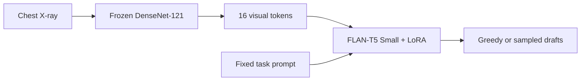

# CXR-Sentry

**Status: Generator pipeline research prototype.**

CXR-Sentry generates draft chest X-ray reports and studies how to prioritize them for review. The retrospective study combines uncertainty across sampled drafts with disagreement from a separate image verifier to identify reports that may contain unsupported findings or omissions.



[Install](#install) · [Quick start](#quick-start) · [Research workflow](#research-workflow) · [Contributing](#contributing) · [License and support](#license-and-support)

## Install

Prerequisites are Git and Python 3.13. Clone the repository and enter it:

```text
git clone https://github.com/Shivank19/CXR-Sentry.git
cd CXR-Sentry
```

Create and activate a virtual environment:

```cmd
py -3.13 -m venv .venv
.venv\Scripts\activate.bat
set "PYTHONPATH=%CD%\src"
```

Install a matching `torch` and `torchvision` pair for your OS and accelerator. Then install the remaining dependencies. [PyTorch installation selector](https://pytorch.org/get-started/locally/)

```text
python -m pip install -r requirements.txt
python -m pip check
```

## Quick start

Run these commands from the repository root after completing [installation](#install). This workflow starts with a prepared IU/Open-I manifest and its selected frontal PNGs.

### 1. Make the prepared data available

The commands below use this layout. Substitute your actual paths if the data is stored elsewhere.

```text
data/iu/
├── manifest.csv
└── images/
```

The manifest has one row per study and columns `study_id`, `image_path`, `split`, and `reference_text`. Image paths are relative to `images/`. Use the supplied split assignments. Training requires `train` and `dev`, and the evaluation commands below use `test`. See the [manifest contract](docs/generator.md#dataset-and-run-paths) for report formatting and additional split names.

### 2. Train on the full training split

Pass the **full manifest** to `cxr_sentry.generator.train`, the training entry point. Each epoch processes every `train` row and validates on every `dev` row. Use a new run directory for each run. The settings below are an example configuration. With a CUDA-enabled PyTorch installation, use `--device cuda` where these examples use `--device cpu`.

```text
python -m cxr_sentry.generator.train --manifest data/iu/manifest.csv --image-root data/iu/images --run-dir runs/baseline-01 --device cpu --epochs 3 --batch-size 2 --learning-rate 0.0001 --seed 42
python -m cxr_sentry.generator.plot_metrics --run-dir runs/baseline-01
```

Training writes `metrics.csv` and saves the lowest-dev-loss model to `best_checkpoint/`. Plotting writes `loss_curves.png` and `loss_curves.svg` in the same run directory.

### 3. Export drafts for every study in a split

The export command uses the full manifest and writes one greedy draft for **every** `test` row, along with mean token negative log-likelihood and the scored token count. Repeat with a different `--split` and output filename for any other split required by the study.

```text
python -m cxr_sentry.generator.export --checkpoint runs/baseline-01/best_checkpoint --checkpoint-id baseline-01 --manifest data/iu/manifest.csv --image-root data/iu/images --split test --output runs/baseline-01/greedy_test.csv --device cpu --max-new-tokens 128
```

### 4. Evaluate image dependence

With at least two test studies, compare the correct image, an image from another study, and a constant image. The commands produce a per-study CSV, a condition summary, and PNG/SVG figures.

```text
python -m cxr_sentry.generator.evaluate_image_dependence --checkpoint runs/baseline-01/best_checkpoint --manifest data/iu/manifest.csv --image-root data/iu/images --split test --output runs/baseline-01/image_dependence_test.csv --device cpu --max-new-tokens 128 --seed 42
python -m cxr_sentry.generator.plot_image_dependence --input runs/baseline-01/image_dependence_test.csv
```

To inspect a checkpoint on one image, see [single-image generation](docs/generator.md#generate-and-export). The `--samples` option controls how many drafts are drawn from that image. Corpus-wide sampled generation can reuse the same generation API from a manifest loop.

## Research workflow

The [generator guide](docs/generator.md) documents the input contract, checkpoint contents, export scoring rules, and [what to record to reproduce a run](docs/generator.md#reproducing-a-run).

The study uses reference-report disagreements as error proxies and evaluates review budgets of 10%, 20%, and 30%, with 20% as the primary budget. Full-data training and benchmark figures are pending.

## Contributing

Use a branch for each change and open a focused pull request. Describe what changed and which commands you ran to verify it. Keep datasets, model weights, checkpoints, and run outputs out of Git.

## License and support

A project license has yet to be specified. Report bugs and ask usage questions in [GitHub Issues](https://github.com/Shivank19/CXR-Sentry/issues).
